<div align="center">

# Text → Sign Language

**Type a sentence. A 3D avatar signs it.**

Browser-based, accessibility-first, with no video playback anywhere in the pipeline.
Every movement is numeric bone rotation data driving a rigged character in real time.

[](https://github.com/37OMKAR/signlanguage/actions/workflows/ci.yml)


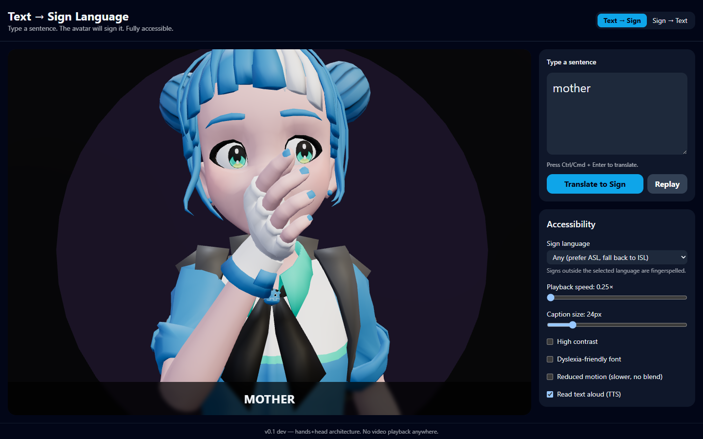

</div>

> [!IMPORTANT]
> **Work in progress.** This is an early alpha built in the open and improved continuously: audit, fix, learn, repeat. Some signs are wrong and none have been reviewed by a signer yet. It is not a replacement for a human interpreter.
> **Suggestions of any kind help**, especially from Deaf and hard-of-hearing signers and interpreters. Please [open an issue](https://github.com/37OMKAR/signlanguage/issues/new/choose) (there is a *Sign correction* template) or send a pull request.

---

## Contents

- [Highlights](#highlights)
- [Gallery](#gallery)
- [Quick start](#quick-start)
- [How it works](#how-it-works)
- [Project layout](#project-layout)
- [Vocabulary and data](#vocabulary-and-data)
- [Accessibility](#accessibility)
- [Accuracy: where this stands today](#accuracy-where-this-stands-today)
- [Roadmap](#roadmap)
- [Scripts](#scripts)
- [Documentation](#documentation)
- [Licensing and credits](#licensing-and-credits)
- [Contributing](#contributing)

## Highlights

- **Text to signing avatar.** A full-body rigged character with articulated fingers, arms, eyebrows, eyelids and head, rendered with Three.js and `@react-three/fiber`.
- **Body-anchored signs.** Signs say *where* the hand goes (`chin`, `forehead`, `chest`, ...) and a two-bone IK solver reaches there, so MOTHER touches the chin and FATHER touches the forehead. See [Arm IK](docs/ARM_IK.md).
- **ASL-style grammar layer.** Rule-based English-to-gloss conversion drops articles and copulas, moves time words to the front and wh-words to the end, and collapses "I love you" into its single idiomatic sign. Non-manual markers (raised or furrowed brows, head shake for negation) are held for the whole sentence.
- **Fingerspelling fallback.** Any word without a sign is spelled letter by letter (A-Z).
- **Sign → Text.** A second tab reads fingerspelling from your webcam in the browser using MediaPipe hand landmarks. Nothing leaves your device.
- **Accessibility built in.** Adjustable captions, playback speed, high contrast, dyslexia-friendly font, reduced motion and text-to-speech that follows each sign. See [Accessibility](#accessibility).
- **ASL and ISL.** Choose American or Indian Sign Language, or let the app prefer ASL and fall back to ISL.
- **Optional AI glossing.** Plug in Gemini, Claude, DeepSeek or LongCat through a small server-side proxy. The browser never sees an API key, and the app falls back to the rules if the proxy is down.
- **Tested.** Vitest suite for compilation, NLP rules, the loader, the handshape classifier and the arm solver. Lint, type-check, tests, licence check and build run in CI.

## Gallery

<table>
  <tr>
    <td align="center">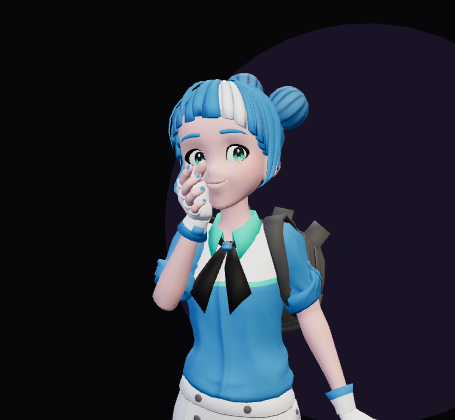<br><b>MOTHER</b><br><sub>thumb at the chin</sub></td>
    <td align="center">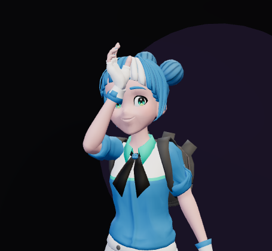<br><b>FATHER</b><br><sub>thumb at the forehead</sub></td>
    <td align="center">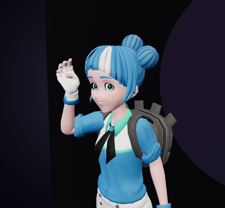<br><b>HELLO</b><br><sub>salute from the temple</sub></td>
  </tr>
  <tr>
    <td align="center">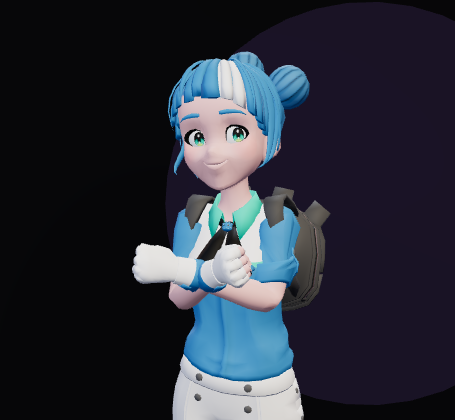<br><b>LOVE</b><br><sub>two-handed, crossed at the chest</sub></td>
    <td align="center">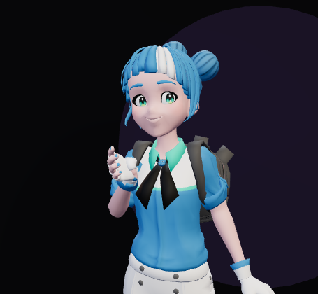<br><b>HAPPY</b><br><sub>chest, repeated</sub></td>
    <td align="center">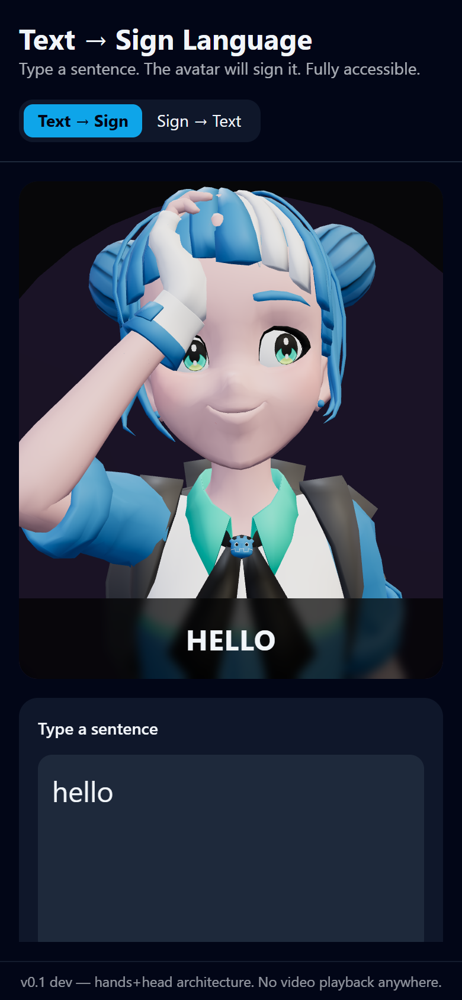<br><b>Mobile</b><br><sub>responsive layout</sub></td>
  </tr>
</table>

<p align="center">
  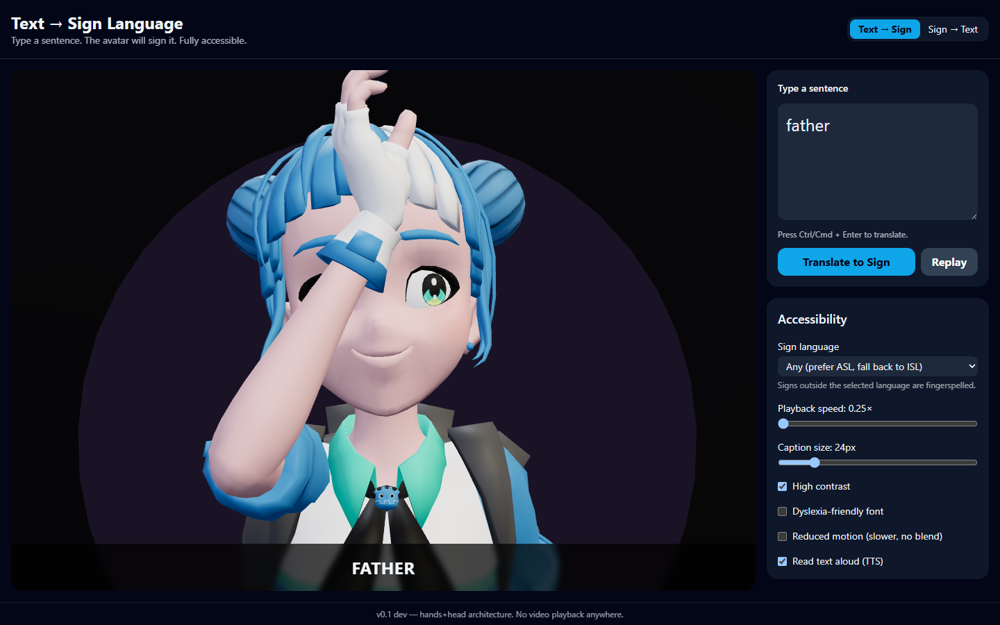
  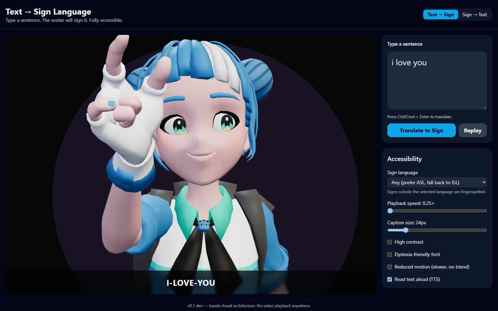
</p>

> Screenshots are real renders from the running app (headless Chrome, software WebGL), captured at 0.25x playback speed so the pose is easy to see.

## Quick start

Requires **Node 20+**.

```bash
git clone https://github.com/37OMKAR/signlanguage.git
cd signlanguage
npm install
npm run dev
```

Open <http://localhost:5173>, type `hello how are you`, and press **Ctrl/Cmd + Enter**.

Things to try:

| Input | What you will see |
|---|---|
| `mother`, `father` | Hand reaches the chin / forehead |
| `i love you` | The single ILY handshape, not three signs |
| `what is your name?` | Wh-word moved to the end, furrowed brows |
| `are you hungry?` | Yes/no question, raised brows |
| `i do not know` | Head shake layered on the negation |
| `yes yes yes` | Repeated signs play in sequence |
| `zebra` | No dictionary entry, so it is fingerspelled Z-E-B-R-A |

Production build: `npm run build` then `npm run preview`.

## How it works

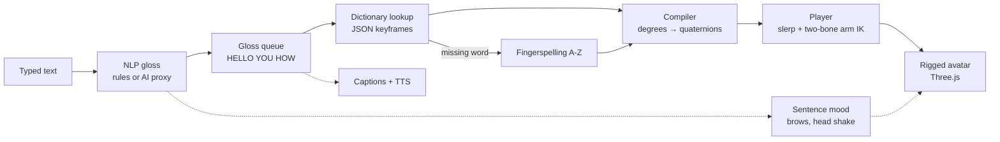

1. **Text → gloss** (`src/nlp`). `compromise` plus ASL-style reordering and lemmatisation. An optional AI proxy can do this step instead, with the rules as fallback.
2. **Dictionary** (`data/gloss_dictionary.json`). Each sign is a list of keyframes: finger curls in degrees, palm rotation, and optional body anchors for the wrist.
3. **Compiler** (`src/signs/compile.ts`). Turns authored degrees into quaternions and carries body anchors forward between frames.
4. **Player** (`src/components/Godette.tsx`). Interpolates keyframes, eases between signs, runs the arm IK, and layers idle breathing, blinking and the grammar face markers on top.
5. **Captions and speech** (`src/components/CaptionOverlay.tsx`, `src/a11y/tts.ts`). The current sign is captioned and spoken as it starts.

<p align="center">
  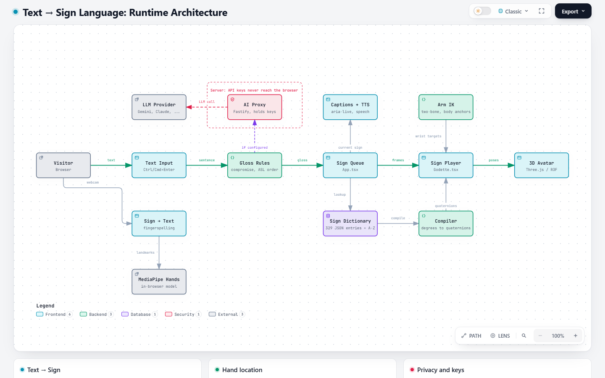
  <br><sub>Runtime architecture. <a href="docs/architecture-diagram.html">Interactive version</a> (download and open locally).</sub>
</p>

Details: [Architecture](docs/ARCHITECTURE.md), [Arm IK](docs/ARM_IK.md), [Data format](docs/DATA_FORMAT.md), [Retargeting](docs/RETARGETING.md).

## Project layout

```text
.
├── src/
│   ├── App.tsx                 # sign queue, settings, tabs
│   ├── components/
│   │   ├── AvatarStage.tsx     # canvas, lights, camera tracking
│   │   ├── Godette.tsx         # avatar rig driver (fingers, arms, face)
│   │   ├── SignRecognizer.tsx  # Sign → Text (webcam, MediaPipe)
│   │   ├── ControlsPanel.tsx   # accessibility settings
│   │   └── ...
│   ├── nlp/                    # text → gloss rules, sentence mood
│   ├── signs/
│   │   ├── armIK.ts            # two-bone IK + body anchors
│   │   ├── compile.ts          # authored JSON → runtime quaternions
│   │   ├── loader.ts           # dictionary access, language filter, fingerspelling
│   │   └── handshapeClassifier.ts
│   ├── ai/                     # optional LLM glossing via proxy
│   └── a11y/tts.ts
├── data/                       # sign dictionary + data licence ledger
├── public/                     # avatar models (glTF/GLB)
├── scripts/
│   ├── ai-proxy/               # Fastify proxy that keeps API keys server-side
│   └── data-prep/              # Python tools: MediaPipe / Kaggle → dictionary
├── tests/                      # Vitest suites
└── docs/                       # architecture, data format, audit, screenshots
```

## Vocabulary and data

The dictionary ships **329 entries**:

| Source | Entries | Language | Commercial use | Contents |
|---|---:|---|---|---|
| Hand-authored | 74 | ASL | Yes | 26 letters + 48 common words, authored by hand |
| SignMatic ASL Keypoint Dataset (CC BY 4.0) | 18 | ASL | Yes, with attribution | Finger curls retargeted from real recordings |
| AI4Bharat INCLUDE via Kaggle | 237 | ISL | **Not cleared yet** | Finger curls only, one take per word |

35 signs currently use body anchors for hand location. Every entry records its `provenance` and `commercial_safe` flag, and a test fails the build if a research-only entry is marked safe. The full ledger is in [`data/LICENSE-DATA.md`](data/LICENSE-DATA.md).

## Accessibility

Targeting WCAG 2.2 AA. Shipped today:

- Large, resizable captions with `aria-live` announcements
- Playback speed from 0.25x to 2x and a reduced-motion mode
- High-contrast theme and a dyslexia-friendly font option
- Speech that follows each sign, with the best installed voice picked automatically
- Keyboard-only use (Ctrl/Cmd + Enter to translate), visible focus rings
- Responsive layout down to phone width

See [docs/ACCESSIBILITY.md](docs/ACCESSIBILITY.md) for the full table and what is not claimed yet.

## Accuracy: where this stands today

This is an **alpha** and it is not a substitute for a human interpreter. Honest status, from the project's own [audit](docs/AUDIT.md):

- Hand-authored signs are best-effort and **have not been reviewed by a Deaf signer**. Their notes say so.
- The 237 ISL entries carry finger shapes only, with no wrist motion or location, so many read as in-place finger movement.
- The hand model bends each joint on one axis. It has no finger spread, thumb rotation or wrist twist yet, so some letters are indistinguishable (U/V, G/L/Q, K/P) and R, M, N, T and E are approximate.
- Hand location is solved by IK for 35 signs; the rest use a generic lift.
- Known visual issues: EAT lands near the eye, THANK-YOU is not a flat hand, and the avatar always smiles.
- Grammar is rule-based: no classifiers, spatial pronouns or plural reduplication.

Feedback from Deaf signers and interpreters is the most valuable contribution this project can get. See [Contributing](#contributing).

**How the project learns:** each round is *audit → fix → document → ask for feedback*. The latest audit is in [docs/AUDIT.md](docs/AUDIT.md), and every open problem listed there is a candidate for your suggestions.

## Roadmap

- [x] Rigged full-body avatar with finger, arm and face control
- [x] Rule-based ASL-style gloss, question and negation markers
- [x] Fingerspelling fallback and Sign → Text fingerspelling recogniser
- [x] ASL / ISL selection
- [x] Body-anchored arm IK for location signs
- [ ] Richer hand model: finger spread, thumb rotation, wrist twist
- [ ] Hand-to-hand contact and two-handed choreography
- [ ] Anchors and palm orientation for the remaining ~290 signs
- [ ] Signer-reviewed core vocabulary (about 100 words)
- [ ] Blending between signs (co-articulation) and `noBlend` flags
- [ ] Face blendshapes, mouth shapes and eye gaze
- [ ] **Next: Video → ASL.** Take speech from a video, transcribe it, and sign it with the avatar in sync with playback
- [ ] **Then: Audio → ASL.** Live microphone or audio-file speech to a signing avatar, using the same text pipeline
- [ ] Hindi and other Indian-language input
- [ ] Per-sign pose regression tests

### Direction: text → video → audio

Text is the foundation because every later input reduces to it. The plan is to add inputs in this order, reusing the same gloss, dictionary and avatar pipeline:

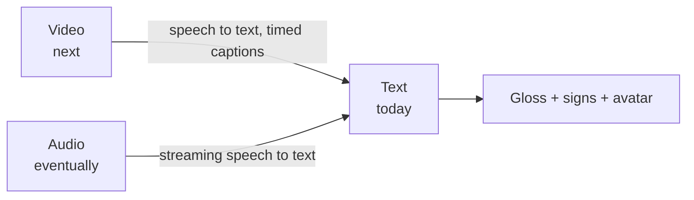

- **Video → ASL (next).** Extract the audio track, transcribe it with timestamps, and queue signs against those timestamps so the avatar stays in step with the video.
- **Audio → ASL (eventually).** Live and recorded speech through streaming speech recognition, with the signing avatar following along. This needs low-latency sentence chunking and is the hardest of the three.

Both depend on the accuracy work above, since a wrong sign is more costly when it is produced automatically.

Longer plan and risk register: [PLAN.md](PLAN.md).

## Scripts

| Command | What it does |
|---|---|
| `npm run dev` | Vite dev server on port 5173 |
| `npm run build` | Type-check and production build |
| `npm run preview` | Serve the production build |
| `npm test` | Vitest suite (includes the sign commercial-safety audit) |
| `npm run lint` | ESLint |
| `npm run license:check` | Fails on dependencies outside the allowed licence list |

Optional AI glossing: copy `.env.example`, point `VITE_AI_PROXY_URL` at the proxy in [`scripts/ai-proxy`](scripts/ai-proxy/README.md), and run it with your own provider key. Without it the app uses the rule-based path and needs no network.

## Documentation

| Doc | Topic |
|---|---|
| [ARCHITECTURE](docs/ARCHITECTURE.md) | Layers and data flow |
| [ARM_IK](docs/ARM_IK.md) | Body anchors and the arm solver |
| [DATA_FORMAT](docs/DATA_FORMAT.md) | Dictionary schema |
| [RETARGETING](docs/RETARGETING.md) | Turning motion-capture landmarks into bone rotations |
| [ACCESSIBILITY](docs/ACCESSIBILITY.md) | WCAG coverage |
| [LICENSING](docs/LICENSING.md) | Code, model and data licences |
| [AUDIT](docs/AUDIT.md) | Code and sign-accuracy audit with fixes |
| [DEVLOG](docs/DEVLOG.md) | Build log from the early milestones |
| [PLAN](PLAN.md) | Roadmap, risks and timeline |

## Licensing and credits

- **Code**: [Personal Use License](LICENSE). Source-available, **not** free or open-source: personal, non-commercial use only; commercial use, redistribution and hosting need written permission. Copies obtained before 11 Oct 2026 remain under MIT. Third-party components and data keep their own licences (below).
- **Sign data**: per-entry provenance, see [`data/LICENSE-DATA.md`](data/LICENSE-DATA.md). Entries derived from the INCLUDE dataset are not cleared for commercial use.
- **SignMatic ASL Keypoint Dataset** by Joseph Sarkis et al. (Lebanese International University), CC BY 4.0, used for the 18 `signmatic-asl` entries.
- **AI4Bharat INCLUDE** dataset (via a Kaggle repackaging) for the ISL entries.
- **"Rigged hand"** by [Elena FF](https://sketchfab.com/elenaferfor), [CC BY-SA 4.0](http://creativecommons.org/licenses/by-sa/4.0/), at `public/rigged-hand/`.
- **Avatar "Godette"** at `public/godette/godette.glb`. The original author and licence still need to be confirmed and credited here before any public release; see [docs/LICENSING.md](docs/LICENSING.md).
- Built with React, Vite, Tailwind CSS, Three.js, `@react-three/fiber`, `@react-three/drei`, `compromise` and MediaPipe Tasks Vision.

## Contributing

Contributions are welcome, especially sign corrections from fluent signers. Please read [CONTRIBUTING.md](CONTRIBUTING.md) first. In short: run `npm run lint && npx tsc --noEmit && npm test` before opening a pull request, and never add sign data without recording its provenance.
